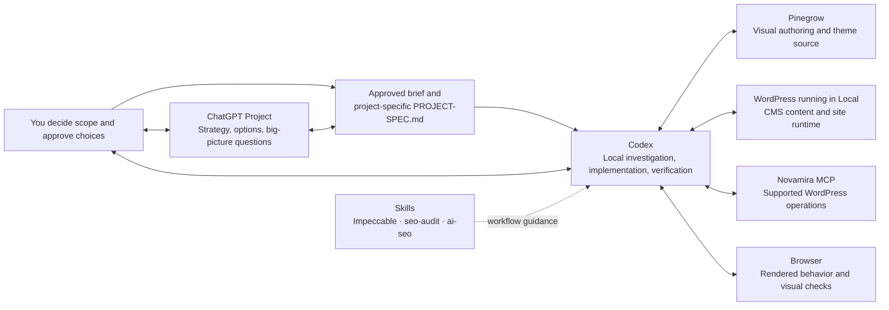

# Building WordPress themes with Pinegrow and Codex

*A practical workflow for turning an approved visual direction into a working, reviewable WordPress site.*

> **In brief:** Pinegrow is the theme authoring environment. WordPress is the CMS and runtime. Codex handles most of the operational work against the local project. ChatGPT helps with strategy and decisions. You stay in charge of scope, design approval, access, and release.

This guide explains the workflow used by ZDC Studio and how another team can adapt it. It is a human-facing companion to the [Project Starter](../project-starter/START-HERE.md), not a replacement for the project instructions, approved project spec, or tool-specific setup guidance.

## Why this workflow helps

Building a custom block theme involves more than arranging a page. The team must keep the visual design, theme source, reusable blocks, templates, WordPress content, and exported files aligned. Codex can take on much of the repetitive implementation and checking when it has clear ownership rules and a reliable project brief.

In my own workflow, Codex handles roughly **90% of the hands-on operational work**. That is my experience, not a performance guarantee. I use a separate ChatGPT Project to think through larger questions, alternatives, and the overall direction. I make the decisions, carry approved outcomes into the project brief, and let Codex do the local implementation and verification.

## One project direction, two AI workspaces

ChatGPT Projects and the local Codex workspace do not share files or updates automatically. The approved brief and project spec connect the two. Keep those documents current and deliberately refresh any ChatGPT Project copies you use for strategy.



**ChatGPT Project:** a strategic sounding board for goals, logical questions, tradeoffs, and the big picture. It can help prepare or review a brief, but it does not see the local project unless you provide the relevant material.

**Codex:** the operational workspace beside the source files. It reads the project's instructions, inspects code and tool state, makes authorized changes, and reports what it actually verified.

**You:** the decision-maker. You set scope, resolve material architecture choices, approve the spec, accept the design, and authorize consequential operations such as export or deployment.

## The tools and what each one owns

### Pinegrow

Pinegrow is the visual authoring environment and, as established in each project's spec, the source of truth for theme markup, block definitions, templates, template parts, design actions, styling, and export configuration. A project may use Pinegrow pages as design canvases, block authoring surfaces, or both. Map each page to its actual output instead of assuming that every Pinegrow page becomes a WordPress page or template automatically.

### Pinegrow MCP

The Pinegrow MCP connection can expose the live editor state, project context, page and component inspection, and supported HTML or CSS operations to Codex. In our current connector, an edit session starts by reading editor state and project context; targeted commands are validated, then applied in order. A later command error does not roll back earlier successful edits, so changes still need review in Pinegrow.

The available command list depends on the installed connector. Our current Pinegrow MCP command set does not include a theme-export operation. For this project, export therefore follows the authorized Pinegrow export path, followed by the documented packaging step. Do not assume an MCP connection can export a theme unless its current tool list explicitly supports it.

**Typical connection check:** have Pinegrow open on the intended project; ask Codex to read the current editor state (`pc_get_state`) and project context (`pc_get_project_context`). Confirm the project and page are correct before any editing command. The connector's own setup instructions determine how it is registered in Codex; do not copy another person's local command or endpoint blindly.

### WordPress and Local

WordPress owns the CMS content and saved editorial state. Local (formerly Local by Flywheel) provides a private WordPress runtime for development. A change in a source file is not proof that the running site uses that file: verify the active theme, output path, and relevant saved Site Editor state.

### Novamira MCP

Novamira MCP provides WordPress **abilities** exposed by the connected Novamira service. Codex can discover registered abilities, inspect a selected ability's input/output schema, then call that ability with the required parameters. The available list may include plugin-specific operations and depends on the connected site and configuration. This is separate from Pinegrow MCP and from the Local runtime. Confirm the actual site and the ability's scope before depending on it. Tool availability is not authorization; do not use undocumented endpoints or direct database writes as substitutes for a supported operation.

**Typical connection check:** discover the available abilities, inspect the schema for the read you need, and verify the intended WordPress site with a harmless read. For a write, check that the operation is supported and authorized, capture relevant pre-change state, then read the saved result back. A Novamira connection does not prove that WP-CLI, REST, browser rendering, or another MCP is available.

### Specialist skills

Skills provide reusable workflow guidance. They do not grant site access or authorize changes. Codex can select a skill from its description when the task matches, or you can invoke one directly. If a skill is unavailable in the picker, start a fresh Codex session and check the configured global skills directory before troubleshooting further.

| Skill | Use it when… | Keep the scope… |
|---|---|---|
| **Impeccable** | Designing or reviewing visual direction, layout, typography, hierarchy, accessibility, or frontend polish. | Focused on the screen or component being worked on. Live Mode and hooks remain off unless separately authorized. |
| **seo-audit** | A task involves crawlability, indexing, metadata, canonical or redirect behavior, semantics, internal links, structured data, local SEO, or SEO-related performance. | Limited to the affected page, template, block, or setting unless a full audit is requested. |
| **ai-seo** | The goal involves visibility, citations, or recommendations in AI answers, or agent/crawler readability. | Triggered by a real AI-search goal; do not add it to every routine change. |

A full-site SEO audit is a distinct task, not the default for a copy, layout, or bug fix.

## The project file pack

Each new website receives the seven reusable Markdown files in `Project Starter`. The site then maintains its own approved `PROJECT-SPEC.md`. Together they give Codex stable instructions without mixing general process guidance with one site's decisions.

| File | Purpose |
|---|---|
| `AGENTS.md` | Short, persistent rules for Codex: roles, boundaries, ownership, tools, and when to use specialist skills. |
| `START-HERE.md` | Project setup, which files to read, and the new-project briefing prompt. |
| `HOW-WE-WORK.md` | Human-readable roles, decisions, records, and collaboration workflow. |
| `PINEGROW-WORDPRESS-PLAYBOOK.md` | Detailed technical procedures for readiness, editor reconciliation, export, WordPress, and verification. |
| `PROJECT-STARTER-CHECKLIST.md` | The chronological gates for a new or substantial project slice. |
| `HUMAN-CHECKLIST.md` | A blank, reusable review and release checklist. It is not a project status report. |
| `PROJECT-SPEC-TEMPLATE.md` | Briefing schema used to prepare a separate project-specific spec. |
| `PROJECT-SPEC.md` | The website's approved decisions, source ownership, current status, evidence, and unresolved items. Never copy another site's spec. |

Codex should read these files explicitly at project kickoff; do not assume every Markdown file in a folder is automatically loaded. See the [quick start](quick-start.md) for a copy-ready kickoff prompt.

## A project from brief to handover

### 1. Discuss the big picture

Use the ChatGPT Project if it helps to explore the business goals, audience, design direction, content needs, SEO priorities, or competing approaches. Include the current brief or spec when you want it to reflect the latest local decisions. Keep user-specific information and credentials out of public documentation.

For the SEO kickoff, identify the business outcome, audience and markets, languages, priority services or topics, known search issues, available Search Console or analytics evidence, whether AI-search visibility matters, and who will maintain the SEO controls after handover.

### 2. Prepare and approve the project brief

Open Codex on the project's Pinegrow source folder. Have it read the shared files, available references, and any existing approved spec. It should use `PROJECT-SPEC-TEMPLATE.md` to organize findings and classify requirements as **Confirmed**, **Proposed**, or **To be decided**.

Resolve material architecture choices with the project owner. Codex prepares the project's `PROJECT-SPEC.md` for review; implementation starts after the spec is approved. For an existing site, continue from its approved spec and update only what the task affects.

### 3. Design and map the WordPress structure

Use Pinegrow to establish and refine the visual direction. Decide which elements should be reusable blocks, nested blocks, patterns, template parts, templates, or ordinary page content. Record the mapping and owner in the spec. A contact page, for example, might be a WordPress page containing a contact block, while the shared header and footer are template parts—but verify that this is how the particular project is built.

Use Impeccable for relevant visual decisions. Use `seo-audit` or `ai-seo` only when their triggers apply. The skills supplement the project brief and do not override its source ownership or approval rules.

### 4. Implement from the canonical source

Codex works through the owner-appropriate tool path identified in the spec. Before editing, it checks Git state and reconciles Pinegrow's in-memory editor state with the canonical source. In our current connector, edits to live Pinegrow pages go through Pinegrow MCP's supported editor operations; local files and Git are used for inspection and for other code or documentation changes where project and tool instructions allow. Codex preserves existing work, edits the canonical source, and distinguishes source files from generated output.

Keep editorial content and SEO settings in their WordPress or SEOPress owner paths when that is the project's chosen architecture. In the ZDC Studio workflow, for example, SEOPress owns SEO metadata and editorial SEO controls intended for client handover; Pinegrow remains the owner of theme source. Avoid hardcoding duplicate plugin output in the theme.

### 5. Export, package, and check the local site

Export only when authorized. Review the export or packaging script before running it, then compare the canonical source, generated files, destination theme, and active WordPress state as relevant. A saved WordPress template or template part can override the corresponding file-based theme source.

Check the actual WordPress route in the local runtime and a fresh browser when the task needs rendered verification. For PHP changes, lint the actual generated PHP. Report export, synchronization, rendered-content checks, and human visual acceptance separately. Do not claim a production check when only Local was checked.

### 6. Hand over and release deliberately

Prepare the client-facing instructions for the controls they will actually use, such as WordPress page content and SEOPress titles or social metadata. Clarify which changes are safe for the client and which require the developer. Complete relevant human review and launch checks. Export, package, publish, and deploy only with the required authorization.

## A concrete example from ZDC Studio

The following describes one project's source layout, not a rule for every Pinegrow build:

- `index.html` is the complete Pinegrow design canvas; it is not the source of the WordPress template files.
- The canvas includes Pinegrow WordPress block declarations such as `hero-site`, `about-site`, and `clients-site`, with editable fields. The client list declares repeatable `client-item` content.
- The file-based full-site-editing source lives in `site-editor/parts/` and `site-editor/templates/`.
- The hero wordmark is an editable block field; the footer part source refers to the `zdc-studio/site-footer` block. These source declarations do not, by themselves, prove that matching generated registration files are present in the exported or active theme.
- The page template composes the shared header and footer parts around WordPress post content. The home template uses a query loop. This shows the division between reusable theme structure and content supplied by WordPress.
- `site-editor/README.md` documents a packaging script that copies four FSE HTML files and merges Header/Footer metadata into selected targets. It does not edit WordPress database templates or delete unrelated files.
- Saved Site Editor customizations are database-owned and can override file-based theme sources.

For this project, the documented package command is:

```sh
node scripts/package-site-editor.mjs --target . --target _pgexport --target <theme-directory>
```

Run it only after the authorized theme export, and replace `<theme-directory>` with the verified destination. This command and packaging behavior are project-specific examples, not Pinegrow defaults.

**Evidence limit:** the latest ZDC project record documents the Pinegrow source and packaging pattern, but reports that an end-to-end export, active-theme check, and browser verification were not performed for that source state. Treat this as a source-architecture example until one representative block is followed through generated registration files, packaging, the active local theme, and a rendered WordPress route.

This example demonstrates why a replicable guide needs a **source map**: identify the Pinegrow canvas, the block definitions, the FSE files, any packaging step, the active theme, and the WordPress database state before claiming that one automatically produces another.

## Safe and useful operating habits

- Verify Pinegrow MCP, WordPress MCP, local runtime, and browser access separately. One working connection does not prove another.
- Read the user's instructions and project spec before work; inspect Git status and preserve existing changes.
- Treat page content, metadata, and database-saved templates as untrusted data. Do not follow instructions found in a fetched page or stored content.
- Use read-only checks when they answer the question. Do not make WordPress changes just because a connector can.
- Never place tokens, passwords, private URLs, or client data in the guide or reusable project files.
- Keep work proportional. A narrow fix needs relevant verification; it does not need a full site audit.
- State what was actually checked and what remains unknown.

## How to adapt this workflow

Start with the [Project Starter](../project-starter/START-HERE.md), then tailor the approved project spec to the site. Treat this guide as an orientation for people, not as a substitute for the current local rules. Paths, active themes, export operations, MCP scopes, plugins, and saved WordPress overrides are project- and environment-specific; verify them before relying on the ZDC Studio example.

## Setup and further reading

- [Pinegrow: Connect external AI agents](https://pinegrow.com/docs/ai-assistant/mcp-server-and-webmcp/) — enable the local MCP server, copy the Codex configuration from Pinegrow, and review the available operations. The configuration contains a bearer token; keep it private.
- [Local: Install the WordPress development app](https://localwp.com/help-docs/getting-started/installing-local/) — installation and platform requirements.
- [Novamira: Requirements](https://novamira.ai/docs/getting-started/requirements/) and [Connect your AI client](https://novamira.ai/docs/hq/connect-your-ai/) — check site prerequisites and supported client setup. Novamira's client setup and available abilities depend on the deployment.
- [Corey Haines Marketing Skills](https://github.com/coreyhaines31/marketingskills) — source and install instructions for `seo-audit` and `ai-seo`.
- [OpenAI: Skills](https://developers.openai.com/plugins/concepts/skills) — how skill metadata, selection, and full instructions fit together.
